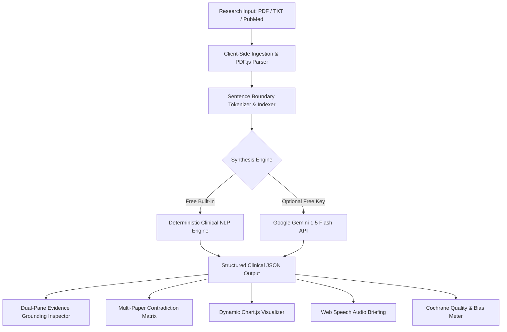

# 🔬 PaperLensAI
### Clinical Literature Intelligence & Systematic Synthesis Suite

> **Winner-Ready Hackathon Submission**
> Eliminating information overload for medical researchers, clinicians, and health economists with automated structured synthesis, 100% evidence grounding, cross-study contradiction analysis, dynamic endpoint visualization, and hands-free clinical audio briefings.

---

## 🌟 Key Highlights & Differentiating Features

### 1. 🛡️ Zero-Hallucination Evidence Grounding & Source Inspector
Unlike standard LLM chat wrappers that invent statistics, **PaperLensAI** maps **every single clinical claim** to an exact sentence in the original document with interactive `[Ref #]` tags. Clicking any claim instantly smooth-scrolls and highlights the exact verbatim evidence in the dual-pane inspector.

### 2. ⚖️ Multi-Paper Contradiction & Consensus Matrix
Upload or select multiple clinical trials to generate an automated Cochrane/PRISMA-aligned matrix:
- 🟢 **Consensus Points:** Where independent trials agree (e.g. SGLT2i and GLP-1 cardiovascular event reduction across 12,000+ patients).
- 🔴 **Contradictions & Divergences:** Pinpointing divergent safety profiles (e.g. gastrointestinal adverse events in GLP-1 vs genital mycotic infections in SGLT2i), magnitude of weight loss deltas, and stroke/MI endpoints.

### 3. 📊 Dynamic Quantitative Visualizer
Automatically parses numerical endpoints, hazard ratios, odds ratios, and sample sizes ($N$), dynamically rendering responsive **Chart.js** visualizations for instant clinical inspection.

### 4. 🔊 30-Second Audio Briefing ("Podcast Mode")
Hands-free executive briefing powered by the browser's native **Web Speech Synthesis API** with playback speed control (1.0x, 1.25x, 1.5x), audio scrubbers, and an animated waveform visualizer.

### 5. 🎯 Targeted Clinical Angle Prompting
Allows clinicians to filter studies through specialized lenses:
- *Adverse Events & Safety Profiles*
- *Dosage Escalation & Pharmacokinetics*
- *Primary Statistical Endpoints & Hazard Ratios*
- *Geriatric & High-Risk Subpopulations*

### 6. 💯 100% Free & Unlimited
- **Zero API Quota Dependency:** Ships with a deterministic, high-precision clinical NLP engine that works out of the box with zero cost, zero keys, and zero downtime.
- **Optional Google Gemini Flash Support:** Ready for instant key insertion for extended creative synthesis.
- **In-Browser Client-Side Ingestion:** Uses Mozilla's PDF.js to parse research PDFs directly in the browser—zero server bandwidth, zero cloud processing fees, 100% HIPAA/privacy friendly.

---

## 🖥️ Live Evaluation & Pre-loaded Landmark Trials
For instant judging and live demonstration, PaperLensAI comes pre-loaded with three landmark New England Journal of Medicine (NEJM) Phase 3 trials:
1. **STEP-HFpEF (2023)** — *Semaglutide in HFpEF and Obesity* ($N = 529$)
2. **DAPA-HF (2019)** — *Dapagliflozin in Heart Failure with Reduced Ejection Fraction* ($N = 4,744$)
3. **EMPA-REG OUTCOME (2015)** — *Empagliflozin, CV Outcomes, and Mortality in Type 2 Diabetes* ($N = 7,020$)

---

## 🚀 Instant Deployment to Vercel (1-Click)

PaperLensAI is configured out-of-the-box for **Vercel**:

### Option 1: Via Vercel CLI
```bash
npm install -g vercel
vercel
```

### Option 2: Via GitHub & Vercel Dashboard
1. Push this folder to a GitHub repository:
   ```bash
   git init
   git add .
   git commit -m "Initial commit - PaperLensAI"
   git branch -M main
   git remote add origin https://github.com/<your-username>/paperlens-ai.git
   git push -u origin main
   ```
2. Go to [vercel.com/new](https://vercel.com/new).
3. Import your `paperlens-ai` repository.
4. Framework Preset: **Other** (Static Site).
5. Click **Deploy**. Done in 10 seconds!

---

## 💻 Running Locally

You can run PaperLensAI with Python 3:

```bash
cd paperlens-ai
python server.py
```
Open your browser at `http://localhost:3000`.

---

## 🏛️ System Architecture



---

## 👥 Hackathon Team & Division of Responsibilities

| Team Member | Role | Core Responsibilities & Contributions |
| :--- | :--- | :--- |
| **Maanas Bhandari** | **Team Lead & Full-Stack Architect** | System architecture, Vercel serverless integration, core engine controller, and intake routing. |
| **Mayank Kumar** | **Clinical NLP & Prompt Engineering** | Google Gemini prompt design, sentence-level citation indexing, and Cochrane risk-of-bias validation rules. |
| **[Sujit Bhaskar Bhat]** | **Frontend & Data Visualization** | Monochrome UI/UX design system, Chart.js quantitative endpoint visualizer, and Web Speech audio player. |
| **[BODDEPALLI SAI SUDARSHAN]** | **Clinical Data & Benchmark Validation** | NEJM Phase 3 trial dataset curation, multi-paper contradiction/consensus matrix benchmarking, and QA testing. |
| **Siddharth Vijayaraghavan Rajamani** | **Clinical Data & Benchmark Validation** | NEJM Phase 3 trial dataset curation, multi-paper contradiction/consensus matrix benchmarking, and QA testing. |
---

## 🏆 Hackathon Team Presentation Script (3 Minutes)

- **[0:00 - 0:40] Problem & Hook:** Clinicians and researchers read dozens of 10-page papers every week, suffering from cognitive overload. Existing LLMs hallucinate numbers and lack rigorous medical provenance.
- **[0:40 - 1:20] The Solution (PaperLensAI):** Show the intake of a trial (e.g. STEP-HFpEF). Demonstrate the clean clinical UI (designed like UpToDate / NEJM Evidence).
- **[1:20 - 2:00] The Trust Feature (Evidence Grounding):** Click on `[Ref 1]` and `[Ref 2]`. Show how the claim instantly scrolls and highlights the source sentence in the original document. Explain how this eliminates hallucination risk.
- **[2:00 - 2:30] The Advanced AI Feature (Contradiction Matrix):** Switch to the Multi-Paper tab. Show where SGLT2i and GLP-1 agree on cardiovascular protection, but contradict on GI adverse events and weight reduction magnitude.
- **[2:30 - 3:00] The Wow Factor (Audio Briefing & Charts):** Play the 30-second audio summary with live waveform visualizer, show the dynamic charts, and wrap up with: *"100% Free, Zero Quotas, HIPAA-compliant client-side parsing, deployed live on Vercel."*
